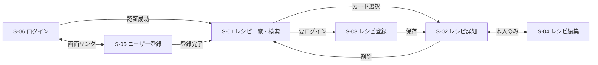

# 画面仕様書

[← 要件定義書に戻る](00_要件定義書.md)

最終更新日: 2026-11-11

## 1. 画面一覧

必須画面は6つ、任意画面は1つ。トップ（レシピ一覧・検索）を起点にする。対応機能の番号は [機能一覧](01_機能一覧.md) の No。

| ID | 画面名 | URL | ログイン | 対応機能 | 状況 |
| --- | --- | --- | --- | --- | --- |
| S-01 | レシピ一覧・検索（トップ） | /（絞り込みは ?filter=favorites / recommended / quick） | 不要（お気に入りのみ必要） | F-03, F-08, F-09, F-15, F-16 | 一覧のみ実装済み |
| S-02 | レシピ詳細 | /recipes/:id | 不要 | F-04, F-07, F-11, F-16 | 実装済み |
| S-03 | レシピ登録 | /recipes/new | 必要 | F-05, F-10, F-12 | 実装済み（ログイン制限なし） |
| S-04 | レシピ編集 | /recipes/:id/edit | 必要（本人） | F-06, F-10 | 実装済み（ログイン制限なし） |
| S-05 | ユーザー登録 | /signup | 不要 | F-01 | 未着手 |
| S-06 | ログイン | /login | 不要 | F-02 | 未着手 |
| S-07 | マイページ（任意） | /mypage | 必要 | F-14 | 未着手 |

## 2. 画面遷移

ゲストは一覧と詳細まで見られる。登録・編集にはログインが必要。

> 図が表示されないときは、VS Code に拡張機能「Markdown Preview Mermaid Support」を入れる。GitHub ではそのまま表示される。

| 遷移元 | 操作・条件 | 遷移先 |
| --- | --- | --- |
| S-06 ログイン | 認証成功 | S-01 レシピ一覧・検索 |
| S-06 ログイン ⇄ S-05 ユーザー登録 | 画面内のリンク | S-05 ⇄ S-06 |
| S-05 ユーザー登録 | 登録完了 | S-01 レシピ一覧・検索 |
| S-01 レシピ一覧・検索 | カードを選択 | S-02 レシピ詳細 |
| S-01 / S-02 | 左サイドバーの項目を選択 | S-01（その項目の条件で絞り込んだ一覧） |
| S-01 / S-02 | 左サイドバーの「お気に入り」（未ログイン） | S-06 ログイン |
| S-01 / S-02 | 右サイドバーのランキングの料理名を選択 | S-02 レシピ詳細 |
| S-01 レシピ一覧・検索 | 「レシピを登録」（要ログイン） | S-03 レシピ登録 |
| S-03 レシピ登録 | 保存成功 | 登録したレシピの S-02 |
| S-02 レシピ詳細 | 「編集する」（本人のみ） | S-04 レシピ編集 |
| S-04 レシピ編集 | 保存成功 | S-02 レシピ詳細 |
| S-02 レシピ詳細 | 「削除する」→ 確認で OK | S-01 レシピ一覧・検索 |

## 3. 共通レイアウト

- すべての画面の上部にヘッダーを表示する。
- ヘッダーには、アプリ名（押すとトップへ）、「一覧」リンク、「レシピを登録」ボタンを置く。
- ログイン機能を作ったら、「ログイン」と「ログアウト」をヘッダーに追加する。
- S-01 レシピ一覧・検索と S-02 レシピ詳細では、本文の左に「絞り込みメニュー」、右に「週間ランキング」を表示する。登録・編集・ログインなどの入力画面には出さない。
- 画面の幅が 960px より狭いときは、絞り込みメニューを本文の上に横並びで出し、ランキングは本文の下に回す。

### 3.1 左サイドバー（絞り込みメニュー）

項目を押すと、S-01 にその条件で絞り込んだレシピを表示する。今いる項目は色を変えて示す。

| 項目 | URL | 表示するレシピ | 並び順 | ログイン |
| --- | --- | --- | --- | --- |
| レシピ一覧 | / | すべての公開レシピ | 新しい順 | 不要 |
| お気に入り | /?filter=favorites | 自分がお気に入りに登録したレシピ | 登録が新しい順 | 必要（未ログインなら S-06 へ自動で移動し、「お気に入りを見るにはログインが必要です」と表示） |
| おすすめレシピ | /?filter=recommended | お気に入りに登録された数が1以上のレシピ | お気に入り数が多い順（同じ数なら新しい順） | 不要 |
| 時短レシピ | /?filter=quick | 調理時間が15分以内のレシピ（調理時間が未入力のものは含めない） | 調理時間が短い順 | 不要 |

- 当てはまるレシピが0件のときは、項目ごとに「お気に入りはまだありません。…」「おすすめできるレシピはまだありません。」「調理時間が15分以内のレシピはまだありません。」と表示する。
- 「おすすめレシピ」はお気に入り（F-11）の登録数で決めるため、F-11 ができてから使えるようになる。

### 3.2 右サイドバー（週間ランキング）

ここ1週間でよく見られたレシピを、左サイドバーと同じ4項目ごとにランキングで表示する。

| 項目 | 内容 |
| --- | --- |
| 切り替え | 「すべて」「お気に入り」「おすすめ」「時短」のタブで切り替える。最初は、今開いている左サイドバーの項目と同じタブを表示する（S-02 では「すべて」） |
| 対象 | 各タブは、左サイドバーの同じ項目の条件に当てはまるレシピだけを対象にする |
| 集計期間 | 今の時刻からさかのぼって7日間 |
| 閲覧数の数え方 | S-02 レシピ詳細が表示されるたびに1回と数える。投稿者本人が見た分も数える |
| 表示件数 | 各タブ上位5件。閲覧数が同じなら新しいレシピを上にする |
| 表示内容 | 順位、料理名、閲覧数（例: 👁 1,240回）。料理名を押すと S-02 に移動する |
| 「お気に入り」タブ | 未ログインのときは「ログインするとお気に入りのランキングが表示されます」と表示する |
| 0件のとき | 「この1週間に見られたレシピはまだありません。」と表示する |

## 4. 画面ごとの仕様

### S-01 レシピ一覧・検索

| 項目 | 内容 |
| --- | --- |
| 表示内容 | 全レシピを新しい順にカードで表示する。カードには料理名・ひとこと説明・調理時間・何人分を出す |
| 0件のとき | 「まだレシピがありません。最初のレシピを登録しましょう。」と表示し、登録画面へのリンクを置く |
| 操作 | カードを押すと S-02 に移動する |
| 検索結果が0件のとき | 「検索結果がありませんでした」と表示する |
| エラー時 | API に接続できないときは「レシピを読み込めませんでした。…」と表示する |
| 未実装 | 検索欄とカテゴリの絞り込み（F-08, F-09）、1ページ12件のページ分け（F-03） |

### S-02 レシピ詳細

| 項目 | 内容 |
| --- | --- |
| 表示内容 | 料理名、ひとこと説明、調理時間、何人分、材料と分量の表、番号つきの手順 |
| 操作 | 「編集する」で S-04 に移動する。「削除する」は確認ダイアログを出し、OK なら削除して S-01 に戻る |
| エラー時 | 存在しない ID のときは「レシピが見つかりませんでした。」と表示する |

### S-03 レシピ登録 ／ S-04 レシピ編集

2つの画面は同じ入力フォームを使う。編集画面では、今の内容が入った状態で開く。

| 項目 | 内容 |
| --- | --- |
| 操作 | 「＋ 材料を追加」「＋ 手順を追加」で入力行を増やし、各行の「削除」で消せる |
| 保存 | 登録は「登録する」、編集は「更新する」で保存し、そのレシピの S-02 に移動する |
| 未ログインのとき | 登録画面は表示せず、S-06 ログインへ自動で移動し、「レシピを登録するにはログインが必要です」と表示する。閲覧（S-01, S-02）はログインなしでできる |
| 本人以外のとき（編集） | 改ざんを防ぐため、本人以外は編集できない。「編集する」ボタンを出さず、URL を直接開いても編集画面は表示せずに S-02 へ移動する。API でも本人以外の更新・削除を拒否する |
| 保存中 | ボタンを「保存中…」にして、二重送信を防ぐ |
| 編集の保存 | 材料と手順は、フォームの内容でまるごと入れ替える。入力エラーのときは何も変わらない |
| エラー時 | フォームの上にエラーメッセージを並べて表示し、入力した内容は残す |

#### 入力項目とチェックのルール

必須は料理名だけで、材料と手順は0件でも保存できる。チェックは API（Rails）で必ず行い、画面でも一部を先に止める。

| 項目 | 必須 | ルール | 画面での制限 |
| --- | --- | --- | --- |
| 料理名 | 必須 | 50文字以内 | 空欄では送信不可、51文字目は入力不可 |
| ひとこと説明 | 任意 | 200文字以内 | 201文字目は入力不可 |
| 調理時間（分） | 任意 | 整数 1〜999 | 数値入力欄、範囲外は送信不可 |
| 何人分 | 任意 | 整数 1〜20 | 数値入力欄、範囲外は送信不可 |
| 材料名 | 材料行を入れるなら必須 | 50文字以内 | 材料名が空の行は保存時に捨てる |
| 分量 | 任意 | 30文字以内（例: 1個、大さじ1） | なし（API でチェック） |
| 手順の内容 | 手順行を入れるなら必須 | 500文字以内 | 空の行は保存時に捨てる |
| 手順番号 | 自動 | 並び順から 1, 2, 3… と振り直す | 入力欄なし |

エラーメッセージは「料理名を入力してください」のように日本語で表示する。

### S-05 ユーザー登録（未着手）

| 項目 | 内容 |
| --- | --- |
| 入力項目 | 名前（20文字以内）、メールアドレス（重複不可）、パスワード（8文字以上16文字未満＝8〜15文字） |
| 操作 | 登録が成功したらログイン状態にして S-01 に移動する。ログイン画面へのリンクを置く |

### S-06 ログイン（未着手）

| 項目 | 内容 |
| --- | --- |
| 入力項目 | メールアドレス、パスワード |
| 操作 | 認証が成功したら S-01 に移動する。失敗したら「メールアドレスまたはパスワードが違います」と表示する |

### S-07 マイページ（任意・未着手）

| 項目 | 内容 |
| --- | --- |
| 表示内容 | 自分が登録したレシピと、お気に入りに登録したレシピ |
