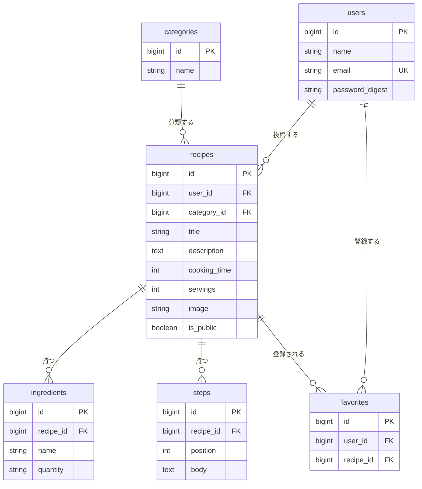

# データベース設計書

[← 要件定義書に戻る](00_要件定義書.md)

最終更新日: 2026-11-06

## 1. 概要

- データベース: MySQL 8（開発は Docker、本番は Amazon RDS for MySQL）
- 文字コード: utf8mb4
- テーブルは6つ。そのうち recipes・ingredients・steps の3つを作成済み。

| テーブル | 内容 | 状況 |
| --- | --- | --- |
| users | ユーザー | 未作成（F-01 で作成） |
| recipes | レシピ | 作成済み（user_id・category_id・image・is_public は未追加） |
| ingredients | 材料 | 作成済み |
| steps | 手順 | 作成済み |
| categories | カテゴリ | 未作成（F-08 で作成） |
| favorites | お気に入り | 未作成（F-11 を実装する場合のみ） |

## 2. ER 図

> 図が表示されないときは、VS Code に拡張機能「Markdown Preview Mermaid Support」を入れる。GitHub ではそのまま表示される。

関係のまとめ:

- 1人のユーザーは、複数のレシピを持つ（users 1 : N recipes）
- 1つのカテゴリには、複数のレシピが属する（categories 1 : N recipes）
- 1つのレシピは、複数の材料と手順を持つ（recipes 1 : N ingredients / steps）
- お気に入りは、ユーザーとレシピの中間テーブル（users N : N recipes）

## 3. テーブル定義

すべてのテーブルに、Rails が自動で作る created_at / updated_at（datetime, NOT NULL）がある。下の表では省略する。

### users（ユーザー）— 未作成

| カラム | 型 | NULL | 制約・説明 |
| --- | --- | --- | --- |
| id | bigint | NO | 主キー |
| name | string | NO | 20文字以内 |
| email | string | NO | 一意 |
| password_digest | string | NO | パスワードをハッシュ化して保存 |

### recipes（レシピ）— 作成済み

| カラム | 型 | NULL | 制約・説明 | 状況 |
| --- | --- | --- | --- | --- |
| id | bigint | NO | 主キー | 作成済み |
| title | string(50) | NO | 料理名、50文字以内 | 作成済み |
| description | text | YES | ひとこと説明、200文字以内 | 作成済み |
| cooking_time | integer | YES | 調理時間（分）、1〜999 | 作成済み |
| servings | integer | YES | 何人分、1〜20 | 作成済み |
| user_id | bigint | NO | 外部キー（users） | 未追加（F-01） |
| category_id | bigint | YES | 外部キー（categories） | 未追加（F-08） |
| image | string | YES | 画像のパス | 未追加（F-12） |
| is_public | boolean | NO | 公開するか、初期値 true | 未追加（F-13） |

### ingredients（材料）— 作成済み

| カラム | 型 | NULL | 制約・説明 |
| --- | --- | --- | --- |
| id | bigint | NO | 主キー |
| recipe_id | bigint | NO | 外部キー（recipes）。レシピを削除すると一緒に削除される |
| name | string | NO | 材料名、50文字以内（例: 玉ねぎ） |
| quantity | string | YES | 分量、30文字以内（例: 1個、大さじ1） |

### steps（手順）— 作成済み

| カラム | 型 | NULL | 制約・説明 |
| --- | --- | --- | --- |
| id | bigint | NO | 主キー |
| recipe_id | bigint | NO | 外部キー（recipes）。レシピを削除すると一緒に削除される |
| position | integer | NO | 手順番号。この順に並べて表示する |
| body | text | NO | 手順の内容、500文字以内 |

### categories（カテゴリ）— 未作成

| カラム | 型 | NULL | 制約・説明 |
| --- | --- | --- | --- |
| id | bigint | NO | 主キー |
| name | string | NO | 一意 |

初期データとして、主菜・副菜・汁物・ご飯もの・デザート・その他 を登録する。

### favorites（お気に入り）— 未作成（任意）

| カラム | 型 | NULL | 制約・説明 |
| --- | --- | --- | --- |
| id | bigint | NO | 主キー |
| user_id | bigint | NO | 外部キー（users） |
| recipe_id | bigint | NO | 外部キー（recipes） |

user_id と recipe_id の組み合わせは一意にする（同じレシピを2回お気に入りにできない）。
