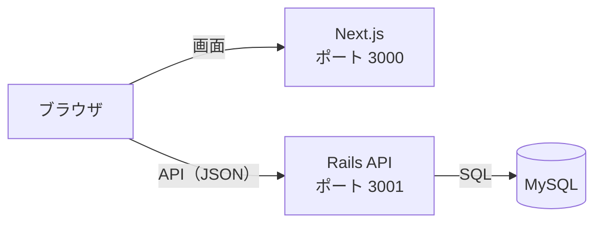

# 技術スタック

[← 要件定義書に戻る](00_要件定義書.md)

最終更新日: 2026-11-11

フロントエンド（Next.js）とバックエンド（Rails API）を分け、JSON でやり取りする。

## 1. 使用技術

| 層 | 技術 | バージョン | 用途 |
| --- | --- | --- | --- |
| フロントエンド | Next.js（App Router） | 15.5 | 画面の表示 |
| | React | 19.1 | 画面の部品 |
| | TypeScript | 5 | 型チェック |
| バックエンド | Ruby | 3.4.12 | |
| | Ruby on Rails（API モード） | 8.0.5 | API サーバー |
| | trilogy | 2.x | MySQL への接続 |
| | rack-cors | — | フロントエンドからのアクセスを許可 |
| | rails-i18n | — | エラーメッセージの日本語化 |
| データベース | MySQL | 8.4 | データの保存 |
| 開発環境 | Docker（Docker Compose） | — | 開発用の MySQL を動かす |
| | rbenv | — | Ruby のバージョン管理 |
| | Node.js | 24 | Next.js の実行 |
| 本番環境 | Amazon EC2 | — | Next.js と Rails を動かす |
| | Amazon RDS for MySQL | 8 | 本番のデータベース |
| バージョン管理 | Git / GitHub | — | |
| 認証（予定） | has_secure_password + トークン認証 | — | F-01, F-02 で導入 |

## 2. システム構成



> 図が表示されないときは、VS Code に拡張機能「Markdown Preview Mermaid Support」を入れる。

| 環境 | Next.js | Rails API | MySQL |
| --- | --- | --- | --- |
| 開発 | localhost:3000 | localhost:3001 | Docker（localhost:3306） |
| 本番 | EC2 | EC2 | Amazon RDS |

## 3. API 一覧

| メソッド | パス | 内容 |
| --- | --- | --- |
| GET | /api/recipes | 一覧（新しい順） |
| GET | /api/recipes/:id | 詳細（材料・手順つき） |
| POST | /api/recipes | 登録 |
| PATCH | /api/recipes/:id | 更新（材料・手順は送った内容で入れ替え） |
| DELETE | /api/recipes/:id | 削除 |

今後追加する予定の API（F-15, F-16）:

| メソッド | パス | 内容 |
| --- | --- | --- |
| GET | /api/recipes?filter=favorites | 自分のお気に入り（要ログイン） |
| GET | /api/recipes?filter=recommended | お気に入り数が多い順 |
| GET | /api/recipes?filter=quick | 調理時間15分以内、短い順 |
| GET | /api/rankings/weekly?filter=all\|favorites\|recommended\|quick | ここ1週間の閲覧数の上位5件 |

GET /api/recipes/:id が呼ばれたときに、recipe_views に閲覧を1件記録する。

## 4. フォルダ構成

```
初級編最終課題用/
├── compose.yaml        開発用 MySQL の設定
├── README.md           起動手順
├── docs/               設計ドキュメント（このフォルダ）
├── frontend/           Next.js
│   └── src/
│       ├── app/        画面（URL ごとのページ）
│       ├── components/ 共通部品（入力フォーム）
│       └── lib/        API を呼ぶ関数
└── backend/            Rails API
    ├── app/
    │   ├── controllers/api/  API の処理
    │   └── models/           データとチェックのルール
    ├── config/               ルーティング・DB 接続・日本語化
    ├── db/migrate/           テーブル作成の履歴
    └── test/                 自動テスト
```
