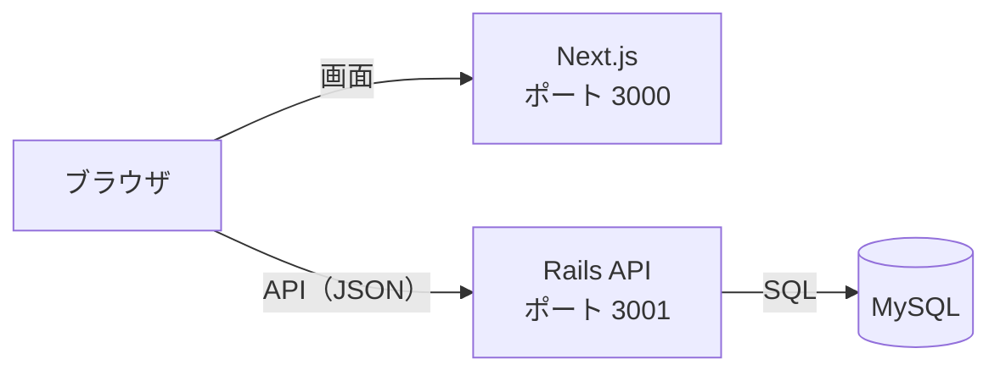
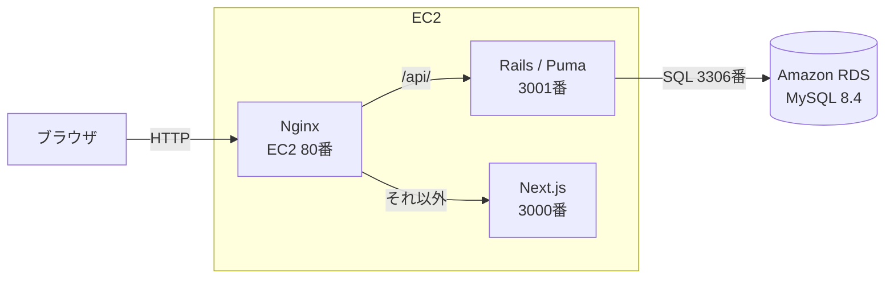

# 技術スタック

[← 要件定義書に戻る](00_要件定義書.md)

最終更新日: 2026-11-11

フロントエンド（Next.js）とバックエンド（Rails API）を分け、JSON でやり取りする。

## 1. 使用技術

| 層 | 技術 | バージョン | 用途 |
| --- | --- | --- | --- |
| フロントエンド | Next.js（App Router） | 15.5 | 画面の表示 |
| | React | 19.1 | 画面の部品 |
| | TypeScript | 5 | 型チェック |
| バックエンド | Ruby | 3.4.12 | |
| | Ruby on Rails（API モード） | 8.0.5 | API サーバー |
| | trilogy | 2.x | MySQL への接続 |
| | rack-cors | — | フロントエンドからのアクセスを許可 |
| | rails-i18n | — | エラーメッセージの日本語化 |
| データベース | MySQL | 8.4 | データの保存 |
| 開発環境 | Docker（Docker Compose） | — | 開発用の MySQL を動かす |
| | rbenv | — | Ruby のバージョン管理 |
| | Node.js | 24 | Next.js の実行 |
| 本番環境 | Amazon EC2 | — | Next.js と Rails を動かす |
| | Amazon Linux 2023 | — | EC2 の OS |
| | Nginx | — | 外からのアクセスを受けて、`/api` は Rails に、それ以外は Next.js に振り分ける |
| | Puma | — | Rails を動かすサーバー（Rails 標準） |
| | systemd | — | Rails と Next.js を自動で起動し、止まったら再起動する |
| | Amazon RDS for MySQL | 8.4 | 本番のデータベース |
| 秘密情報 | 環境変数 + Rails credentials | — | DB のパスワードなどを Git に入れない |
| テスト・チェック | Minitest | — | Rails の自動テスト（Rails 標準） |
| | RuboCop / Brakeman | — | Ruby の書き方チェック / セキュリティチェック |
| | ESLint / tsc | — | TypeScript の書き方チェック / 型チェック |
| バージョン管理 | Git / GitHub | — | |
| 認証（予定） | has_secure_password + トークン認証 | — | F-01, F-02 で導入 |

## 2. システム構成



> 図が表示されないときは、VS Code に拡張機能「Markdown Preview Mermaid Support」を入れる。

| 環境 | Next.js | Rails API | MySQL |
| --- | --- | --- | --- |
| 開発 | localhost:3000 | localhost:3001 | Docker（localhost:3306） |
| 本番 | EC2 | EC2 | Amazon RDS |

本番では、ブラウザは Nginx（80 番ポート）だけにつなぐ。Next.js と Rails は EC2 の中で動かし、外からは直接つながない。



画面と API が同じ URL（EC2 の Elastic IP）になるので、フロントエンドの `NEXT_PUBLIC_API_URL` と Rails の `FRONTEND_ORIGIN` には同じ URL（例: `http://203.0.113.10`）を入れる。

今回は課題のためドメインを用意せず、Elastic IP に HTTP でアクセスする。Rails の `force_ssl` は環境変数 `FORCE_SSL` が `true` のときだけ有効になるので、HTTPS にしない間は設定しない。

## 3. API 一覧

| メソッド | パス | 内容 |
| --- | --- | --- |
| GET | /api/recipes | 一覧（新しい順） |
| GET | /api/recipes/:id | 詳細（材料・手順つき） |
| POST | /api/recipes | 登録 |
| PATCH | /api/recipes/:id | 更新（材料・手順は送った内容で入れ替え） |
| DELETE | /api/recipes/:id | 削除 |

今後追加する予定の API（F-15, F-16）:

| メソッド | パス | 内容 |
| --- | --- | --- |
| GET | /api/recipes?filter=favorites | 自分のお気に入り（要ログイン） |
| GET | /api/recipes?filter=recommended | お気に入り数が多い順 |
| GET | /api/recipes?filter=quick | 調理時間15分以内、短い順 |
| GET | /api/rankings/weekly?filter=all\|favorites\|recommended\|quick | ここ1週間の閲覧数の上位5件 |

GET /api/recipes/:id が呼ばれたときに、recipe_views に閲覧を1件記録する。

## 4. フォルダ構成

```
初級編最終課題用/
├── compose.yaml        開発用 MySQL の設定
├── README.md           起動手順
├── docs/               設計ドキュメント（このフォルダ）
├── frontend/           Next.js
│   └── src/
│       ├── app/        画面（URL ごとのページ）
│       ├── components/ 共通部品（入力フォーム）
│       └── lib/        API を呼ぶ関数
└── backend/            Rails API
    ├── app/
    │   ├── controllers/api/  API の処理
    │   └── models/           データとチェックのルール
    ├── config/               ルーティング・DB 接続・日本語化
    ├── db/migrate/           テーブル作成の履歴
    └── test/                 自動テスト
```

## 5. 本番環境へのデプロイ（EC2 + RDS）

例として、EC2 の Elastic IP を `203.0.113.10`、EC2 のユーザーを `ec2-user`、アプリの置き場所を `/home/ec2-user/app` とする。自分の環境に合わせて置き換える。

### 5.1 AWS 側の準備

| 作るもの | 設定 |
| --- | --- |
| EC2 | Amazon Linux 2023、t3.small 以上（t3.micro だと Next.js のビルドでメモリが足りなくなりやすい）、Elastic IP を付ける |
| RDS | MySQL 8.4、db.t4g.micro、パブリックアクセスは「なし」、初期データベース名 `recipe_app_production` |
| EC2 のセキュリティグループ | 22 番（SSH）は自分の IP だけ、80 番はすべての IP から受け付ける |
| RDS のセキュリティグループ | 3306 番は EC2 のセキュリティグループからだけ受け付ける |

### 5.2 EC2 に必要なものを入れる（初回だけ）

```sh
# Ruby のビルドに必要なもの・Nginx・Git・MySQL の接続確認用
sudo dnf install -y git gcc make patch openssl-devel libyaml-devel libffi-devel \
  readline-devel zlib-devel gdbm-devel ncurses-devel nginx mariadb105

# Ruby 3.4.12（rbenv）
git clone https://github.com/rbenv/rbenv.git ~/.rbenv
git clone https://github.com/rbenv/ruby-build.git ~/.rbenv/plugins/ruby-build
echo 'eval "$(~/.rbenv/bin/rbenv init - bash)"' >> ~/.bashrc
source ~/.bashrc
rbenv install 3.4.12

# Node.js 24
curl -fsSL https://rpm.nodesource.com/setup_24.x | sudo bash -
sudo dnf install -y nodejs
```

RDS につながるか確認する: `mysql -h <RDS のエンドポイント> -u admin -p`

### 5.3 アプリを置く

```sh
git clone <GitHub のリポジトリ URL> ~/app
```

Rails 用の環境変数ファイルを作る。DB のパスワードなどが入るので、Git には入れない。

```sh
sudo mkdir -p /etc/recipe-app
sudo vi /etc/recipe-app/backend.env
sudo chown root:ec2-user /etc/recipe-app/backend.env
sudo chmod 640 /etc/recipe-app/backend.env   # root と ec2-user だけが読める
```

```sh
# /etc/recipe-app/backend.env
RAILS_ENV=production
PORT=3001
DB_HOST=<RDS のエンドポイント>
DB_PORT=3306
DB_USERNAME=admin
DB_PASSWORD=<RDS のパスワード>
DB_NAME=recipe_app_production
FRONTEND_ORIGIN=http://203.0.113.10
RAILS_MASTER_KEY=<手元の backend/config/master.key の中身>
```

### 5.4 Rails をセットアップする

```sh
cd ~/app/backend
bundle config set --local deployment true
bundle config set --local without "development test"
bundle install
set -a; source /etc/recipe-app/backend.env; set +a   # 環境変数を読み込む
bin/rails db:create db:migrate
```

### 5.5 Next.js をビルドする

`NEXT_PUBLIC_` で始まる環境変数はビルドするときに埋め込まれるので、URL を変えたらビルドし直す。

```sh
cd ~/app/frontend
npm ci
NEXT_PUBLIC_API_URL=http://203.0.113.10 npm run build
```

### 5.6 systemd で常に動かす

`/etc/systemd/system/recipe-api.service`

```ini
[Unit]
Description=Recipe App Rails API
After=network.target

[Service]
User=ec2-user
WorkingDirectory=/home/ec2-user/app/backend
EnvironmentFile=/etc/recipe-app/backend.env
ExecStart=/home/ec2-user/.rbenv/shims/bundle exec puma -C config/puma.rb
Restart=always

[Install]
WantedBy=multi-user.target
```

`/etc/systemd/system/recipe-front.service`

```ini
[Unit]
Description=Recipe App Next.js
After=network.target

[Service]
User=ec2-user
WorkingDirectory=/home/ec2-user/app/frontend
Environment=NODE_ENV=production
ExecStart=/usr/bin/npm run start -- -p 3000
Restart=always

[Install]
WantedBy=multi-user.target
```

```sh
sudo systemctl daemon-reload
sudo systemctl enable --now recipe-api recipe-front
sudo systemctl status recipe-api recipe-front
journalctl -u recipe-api -f   # ログを見る
```

### 5.7 Nginx で振り分ける

`/etc/nginx/conf.d/recipe-app.conf`

```nginx
server {
    listen 80;
    server_name _;

    # API は Rails へ
    location /api/ {
        proxy_pass http://127.0.0.1:3001;
        proxy_set_header Host $host;
        proxy_set_header X-Forwarded-For $proxy_add_x_forwarded_for;
        proxy_set_header X-Forwarded-Proto $scheme;
    }

    # それ以外は Next.js へ
    location / {
        proxy_pass http://127.0.0.1:3000;
        proxy_set_header Host $host;
        proxy_set_header X-Forwarded-For $proxy_add_x_forwarded_for;
        proxy_set_header X-Forwarded-Proto $scheme;
    }
}
```

Amazon Linux 2023 の `/etc/nginx/nginx.conf` には最初から 80 番の `server { ... }` があり、そちらが先に使われてしまう。その `server` ブロックをまるごと `#` でコメントアウトしてから、次を実行する。

```sh
sudo nginx -t
sudo systemctl enable --now nginx
```

### 5.8 動作確認

ブラウザで `http://203.0.113.10` を開き、レシピの一覧が表示されることを確認する。表示されないときは `journalctl -u recipe-api -f` と `sudo tail -f /var/log/nginx/error.log` でエラーを見る。

> あとでドメインを用意して HTTPS にする場合は、Certbot（`sudo certbot --nginx -d <ドメイン>`）で証明書を取り、`backend.env` に `FORCE_SSL=true` を足し、URL を `https://<ドメイン>` に変えてビルドし直す。

### 5.9 2回目以降の更新手順

```sh
cd ~/app && git pull
cd backend && bundle install && set -a && source /etc/recipe-app/backend.env && set +a && bin/rails db:migrate
cd ../frontend && npm ci && NEXT_PUBLIC_API_URL=http://203.0.113.10 npm run build
sudo systemctl restart recipe-api recipe-front
```
